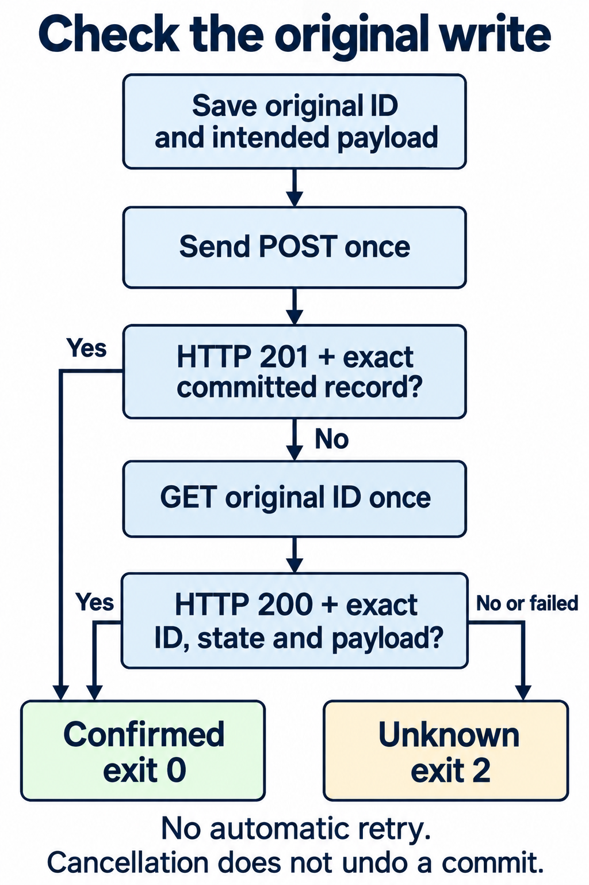

In this synthetic run, PowerShell reported a POST timeout after the API had saved the schedule. Repeating the POST would have created another schedule. The client checked the original operation ID and confirmed the write through a GET before reporting success.

The local API saves configuration for a nightly inventory export; it doesn't run an export. Its lost-response mode deliberately saves the schedule and withholds the response. You can compare the client result with the saved row, including runs where the schedule exists but the client can't confirm it.

## Confirm the write before continuing

An `Invoke-WebRequest` error tells you what the client observed. It doesn't establish whether the server committed the write. [HTTP's idempotency rules](https://www.rfc-editor.org/rfc/rfc9110.html#section-9.2.2) explain why a communication failure alone doesn't justify repeating a non-idempotent request.

This client saves the operation ID and intended payload before sending one POST. It never repeats the POST automatically. A `201` confirms success only if its body contains that exact committed record.

If the POST doesn't confirm the write, the client makes one GET for the original ID; only `200` with the exact record confirms it. Every other API observation leaves the outcome unknown. Stop automation that depends on an unconfirmed write.



The recorded `LostResponse` run used a fixed operation ID; your run generates one by default. The client returned this complete object and exit `0`:

```json
{
  "Outcome": "ConfirmedSuccess",
  "ConfirmedBy": "Readback",
  "OperationId": "f42a9b21-54ed-42ca-b21c-1b8c134af001",
  "WriteStatus": null,
  "WriteError": "System.Threading.Tasks.TaskCanceledException: The request was canceled due to the configured HttpClient.Timeout of 3 seconds elapsing.",
  "ReadStatus": 200,
  "ReadError": null,
  "Reason": "ExactCommittedRecord"
}
```

Readback confirmed the saved schedule, and `WriteError` still contains the POST timeout. An independent file check found the saved record while the client was still waiting. When the client finished, the request journal held one POST and one GET; the schedule file held one exact record.

## Start the API in terminal A

You need PowerShell 7.6, two terminals, a writable directory and free loopback port `8765`. Everything runs locally, with no modules or credentials.

The recorded results come from programmatic execution on macOS 26.3.2 ARM64 with PowerShell 7.6.9 and .NET 10.0.14. The instructions below weren't executed as an interactive terminal A/B session. Execution on Windows, Linux and Windows PowerShell 5.1 remains unverified.

In terminal A, start PowerShell:

```powershell
pwsh -NoProfile
```

Wait for the new PowerShell prompt, then paste these commands to create the lab folder:

```powershell
$PSVersionTable.PSVersion
New-Item -ItemType Directory -Path './api outcome lab'
Set-Location -LiteralPath './api outcome lab'
(Get-Location).Path
```

Save the complete server listing as `server.ps1` in that folder:

```powershell
param(
    [Parameter(Mandatory)][string]$RunDirectory,
    [ValidateSet('Normal', 'LostResponse', 'ReadbackUnavailable', 'ReadbackMissing',
        'ReadbackMismatch', 'ReadbackLost')][string]$Scenario = 'LostResponse',
    [ValidateRange(1024, 65535)][int]$Port = 8765
)
$ErrorActionPreference = 'Stop'
Set-StrictMode -Version Latest

function Send-Json($Context, [int]$Status, $Value) {
    $bytes = [Text.Encoding]::UTF8.GetBytes(($Value | ConvertTo-Json -Depth 6 -Compress))
    $Context.Response.StatusCode = $Status
    $Context.Response.ContentType = 'application/json; charset=utf-8'
    $Context.Response.ContentLength64 = $bytes.Length
    $Context.Response.OutputStream.Write($bytes, 0, $bytes.Length)
    $Context.Response.Close()
}

function Hold-Response($Context) {
    if ($held.Count -ge 8) { throw 'Eight held responses reached. Stop this lab run.' }
    $held.Add($Context)
}

function Save-Schedule($Context, [string]$Body) {
    $request = $Body | ConvertFrom-Json
    $record = [ordered]@{
        operationId = $request.operationId
        state = 'committed'
        payload = $request.payload
    }
    $line = $record | ConvertTo-Json -Depth 6 -Compress
    [IO.File]::AppendAllText($schedulePath, $line + "`n")
    $saved.Add($record)
    if ($Scenario -eq 'Normal') {
        Send-Json $Context 201 $record
        return
    }
    Hold-Response $Context
}

function Read-Operation($Context, [string]$Id) {
    if ($Scenario -eq 'ReadbackLost') { Hold-Response $Context; return }
    if ($Scenario -eq 'ReadbackUnavailable') { Send-Json $Context 503 @{}; return }
    if ($Scenario -eq 'ReadbackMissing') { Send-Json $Context 404 @{}; return }
    $matches = @($saved | Where-Object { $_.operationId -ceq $Id })
    if ($matches.Count -eq 0) { Send-Json $Context 404 @{}; return }
    if ($matches.Count -ne 1) { Send-Json $Context 409 @{}; return }
    $record = $matches[0] | ConvertTo-Json -Depth 6 | ConvertFrom-Json
    if ($Scenario -eq 'ReadbackMismatch') { $record.payload.timeUtc = '03:30' }
    Send-Json $Context 200 $record
}

function Receive-Request($Context) {
    $reader = [IO.StreamReader]::new($Context.Request.InputStream, [Text.Encoding]::UTF8)
    try { $body = $reader.ReadToEnd() } finally { $reader.Dispose() }
    $method = $Context.Request.HttpMethod
    $path = $Context.Request.RawUrl
    $entry = @{ method = $method; path = $path; body = $body } | ConvertTo-Json -Compress
    [IO.File]::AppendAllText($requestPath, $entry + "`n")
    if ($method -ceq 'POST' -and $path -ceq '/schedules') {
        Save-Schedule $Context $body
        return
    }
    if ($method -ceq 'GET' -and $path.StartsWith('/operations/', [StringComparison]::Ordinal)) {
        Read-Operation $Context $path.Substring(12)
        return
    }
    Send-Json $Context 404 @{}
}

$directory = New-Item -ItemType Directory -Path $RunDirectory
$schedulePath = Join-Path $directory.FullName 'schedules.jsonl'
$requestPath = Join-Path $directory.FullName 'requests.jsonl'
$saved = [Collections.Generic.List[object]]::new()
$held = [Collections.Generic.List[object]]::new()
$listener = [Net.HttpListener]::new()
$listener.Prefixes.Add("http://127.0.0.1:$Port/")
try {
    $listener.Start()
    Write-Output "READY http://127.0.0.1:$Port/ $Scenario"
    while ($listener.IsListening) {
        $pending = $listener.GetContextAsync()
        while (-not $pending.Wait(100)) { }
        Receive-Request $pending.GetAwaiter().GetResult()
    }
} finally {
    foreach ($context in $held) { $context.Response.Abort() }
    $listener.Close()
}
```

The server appends each request to `requests.jsonl` and each created schedule to `schedules.jsonl`. It closes the schedule-file append before handling the response, so a response failure can leave a saved schedule behind. In `LostResponse`, it keeps the unanswered HTTP context in memory and continues accepting requests, allowing the client's GET to reach it.

Start the server in the foreground:

```powershell
pwsh -NoProfile -File ./server.ps1 -RunDirectory './run-lost' -Scenario LostResponse
```

Wait for `READY http://127.0.0.1:8765/ LostResponse`. The run directory must be new and the port free, or startup fails. Use a fresh run directory for each scenario.

The fixture can hold eight responses; the next attempted hold throws. If a POST reaches that guard, its schedule has already been appended, and throwing doesn't undo the append. This boundary hasn't been runtime tested.

## Save the intent in terminal B

Open a fresh terminal in the parent directory where you created the lab folder. Start PowerShell:

```powershell
pwsh -NoProfile
```

Wait for the new PowerShell prompt, then paste the command to select the lab folder:

```powershell
Set-Location -LiteralPath './api outcome lab'
```

Save the following listing as `client.ps1`. Before it sends anything, the client writes the original operation ID and intended payload to `intent.json`. That gives you something to compare with the server's record if the response is lost. `CreateNew` refuses an existing intent file before networking; another invocation won't automatically resume or resend it.

The saved intent lets the client ask whether this operation committed the schedule you requested. The response must have the required status and pass JSON decoding, shape and type checks before the client compares its record with that intent. That decision determines whether readback is needed. Transport failures retain their diagnostics; unexpected local errors still throw.

```powershell
param(
    [ValidateRange(1024, 65535)][int]$Port = 8765,
    [guid]$OperationId = [guid]::NewGuid(),
    [string]$IntentPath = './intent.json'
)
$ErrorActionPreference = 'Stop'
Set-StrictMode -Version Latest

function Get-JsonString($Value) {
    if ($Value -is [Text.Json.JsonElement]) {
        if ($Value.get_ValueKind().ToString() -ne 'String') { throw 'Expected a JSON string element' }
    } elseif ($Value -isnot [Text.Json.JsonProperty]) {
        throw 'Expected a JSON string element or property'
    }
    try {
        if ($Value -is [Text.Json.JsonProperty]) { return $Value.get_Name() }
        return $Value.GetString()
    } catch [ObjectDisposedException] { throw }
    catch [InvalidOperationException] {
        throw [Text.DecoderFallbackException]::new('Cannot decode provider JSON string.', $_.Exception)
    }
}

function Test-Fields($Element, [string[]]$Names) {
    if ($Element.ValueKind.ToString() -ne 'Object') { return $false }
    $expected = [Collections.Generic.HashSet[string]]::new($Names, [StringComparer]::Ordinal)
    $seen = [Collections.Generic.HashSet[string]]::new([StringComparer]::Ordinal)
    foreach ($property in $Element.EnumerateObject()) {
        $name = Get-JsonString $property
        if (-not $expected.Contains($name)) { return $false }
        if (-not $seen.Add($name)) { return $false }
    }
    return $seen.Count -eq $Names.Count
}

function Test-StringFields($Element, [string[]]$Names) {
    foreach ($name in $Names) {
        if ($Element.GetProperty($name).ValueKind.ToString() -ne 'String') { return $false }
    }
    return $true
}

function Get-RecordReason($Record) {
    if (-not (Test-Fields $Record @('operationId', 'state', 'payload'))) { return 'InvalidShape' }
    if (-not (Test-StringFields $Record @('operationId', 'state'))) { return 'InvalidShape' }
    $payload = $Record.GetProperty('payload')
    if (-not (Test-Fields $payload @('task', 'timeUtc', 'enabled'))) { return 'InvalidShape' }
    if (-not (Test-StringFields $payload @('task', 'timeUtc'))) { return 'InvalidShape' }
    if ($payload.GetProperty('enabled').ValueKind.ToString() -notin @('True', 'False')) {
        return 'InvalidShape'
    }
    $actual = @((Get-JsonString ($Record.GetProperty('operationId'))), (Get-JsonString ($Record.GetProperty('state'))),
        (Get-JsonString ($payload.GetProperty('task'))), (Get-JsonString ($payload.GetProperty('timeUtc'))))
    $expected = @($id, 'committed', $intent.payload.task, $intent.payload.timeUtc)
    for ($i = 0; $i -lt $expected.Count; $i++) {
        if (-not [string]::Equals($actual[$i], $expected[$i], [StringComparison]::Ordinal)) {
            return 'RecordMismatch'
        }
    }
    if ($payload.GetProperty('enabled').GetBoolean() -ne $intent.payload.enabled) { return 'RecordMismatch' }
    return 'ExactCommittedRecord'
}

function Get-ResponseReason($Response, [int]$ExpectedStatus) {
    if ($null -eq $Response) { return 'TransportError' }
    if ([int]$Response.StatusCode -ne $ExpectedStatus) { return "HttpStatus:$($Response.StatusCode)" }
    try { $document = [Text.Json.JsonDocument]::Parse([string]$Response.Content) }
    catch [Text.Json.JsonException] { return 'InvalidJson' }
    try { return Get-RecordReason $document.RootElement }
    catch [Text.DecoderFallbackException] { return 'UndecodableString' }
    finally { $document.Dispose() }
}

function Get-RequestError($Failure) {
    $exception = $Failure.Exception
    $detail = "$($exception.GetType().FullName): $($exception.Message)"
    if ($Failure.FullyQualifiedErrorId -like 'MaximumRedirectExceeded,*') {
        return "$detail $($Failure.ErrorDetails.Message)"
    }
    foreach ($type in @([Net.Http.HttpRequestException], [Threading.Tasks.TaskCanceledException], [TimeoutException])) {
        if ($exception -is $type) { return $detail }
    }
    throw $Failure
}

$id = $OperationId.ToString('D')
$intent = @{ operationId = $id; payload = @{ task = 'inventory-export'; timeUtc = '02:30'; enabled = $true } }
$json = $intent | ConvertTo-Json -Depth 4
$bytes = [Text.Encoding]::UTF8.GetBytes($json)
$file = [IO.File]::Open($IntentPath, [IO.FileMode]::CreateNew)
try { $file.Write($bytes, 0, $bytes.Length) } finally { $file.Dispose() }
$options = @{
    MaximumRetryCount = 0
    MaximumRedirection = 0
    ConnectionTimeoutSeconds = 3
    OperationTimeoutSeconds = 3
    HttpVersion = '1.1'
    DisableKeepAlive = $true
    NoProxy = $true
    SkipHttpErrorCheck = $true
    ErrorAction = 'Stop'
}
$result = [ordered]@{
    Outcome = 'Unknown'; ConfirmedBy = $null; OperationId = $id
    WriteStatus = $null; WriteError = $null; ReadStatus = $null; ReadError = $null; Reason = $null
}
$write = $null
try {
    Invoke-WebRequest @options -Uri "http://127.0.0.1:$Port/schedules" -Method Post `
        -Body $bytes -ContentType 'application/json; charset=utf-8' | ForEach-Object {
            $write = $_
            $result.WriteStatus = [int]$_.StatusCode
        }
} catch {
    $result.WriteError = Get-RequestError $_
}
$result.Reason = Get-ResponseReason $write 201
if ($result.Reason -eq 'ExactCommittedRecord') {
    $result.ConfirmedBy = 'Response'
} else {
    $read = $null
    try {
        Invoke-WebRequest @options -Uri "http://127.0.0.1:$Port/operations/$id" -Method Get | ForEach-Object {
            $read = $_
            $result.ReadStatus = [int]$_.StatusCode
        }
    } catch {
        $result.ReadError = Get-RequestError $_
    }
    $result.Reason = Get-ResponseReason $read 200
    if ($result.Reason -eq 'ExactCommittedRecord') { $result.ConfirmedBy = 'Readback' }
}
if ($null -ne $result.ConfirmedBy) {
    $result.Outcome = 'ConfirmedSuccess'
    [pscustomobject]$result | ConvertTo-Json
    exit 0
}
[pscustomobject]$result | ConvertTo-Json
exit 2
```

The two [web-command timeout settings](https://learn.microsoft.com/en-us/powershell/module/microsoft.powershell.utility/invoke-webrequest?view=powershell-7.6#-connectiontimeoutseconds) limit different waits: `ConnectionTimeoutSeconds` bounds a pending request, and `OperationTimeoutSeconds` limits a stalled stream read. Both are three seconds here. Neither sets a deadline for the whole script or tells the server to roll back. Status-based retries and redirects are disabled.

`SkipHttpErrorCheck` lets the client inspect an error HTTP status without accepting its body as proof of success. Expected transport failures keep their native exception type and message; unexpected local errors throw. [PowerShell's terminating-error handling](https://learn.microsoft.com/en-us/powershell/module/microsoft.powershell.core/about/about_try_catch_finally?view=powershell-7.6) explains how those errors reach `catch`.

## Check the result and the saved schedule

Run the client once in terminal B, then inspect its result and both server files:

```powershell
pwsh -NoProfile -File ./client.ps1
$clientExit = $LASTEXITCODE
"Client exit: $clientExit"
$intent = Get-Content -LiteralPath './intent.json' -Raw | ConvertFrom-Json
Get-Content -LiteralPath './run-lost/schedules.jsonl' | ConvertFrom-Json | Format-List
Get-Content -LiteralPath './run-lost/requests.jsonl' | ConvertFrom-Json | Select-Object method, path
```

For automation, accept success only from a completed invocation with the full `ConfirmedSuccess` object for the original operation ID and native exit `0`. Exit `0` alone isn't enough.

Compare the server files with `intent.json`, counting requests and saved rows separately. A `ConfirmedSuccess` object doesn't establish how many schedules were created. Here, expect one POST to `/schedules` and one GET to `/operations/` followed by the original `$intent.operationId`. The saved record must have that ID, state `committed`, and a payload containing `task: inventory-export`, `timeUtc: 02:30` and Boolean `enabled: true`.

### Check the record against the saved intent

A `200` can carry the wrong schedule: `03:30` doesn't match an intent for `02:30`, and a different operation ID describes another write. Even JSON string `"true"` fails because the saved intent requires the Boolean `true`.

The client uses [JsonDocument](https://learn.microsoft.com/en-us/dotnet/standard/serialization/system-text-json/use-dom#use-jsondocument) to require a root object with exactly `operationId`, `state` and `payload`, and a payload object with exactly `task`, `timeUtc` and `enabled`. Both objects must contain every field once; extra or duplicate fields fail, as does a one-element array.

`operationId`, `state`, `task` and `timeUtc` must be JSON strings whose decoded values match the original ID, `committed`, and the saved task and time. `enabled` must be a real JSON Boolean equal to the intended `true`.

The check compares decoded property names and string values with culture-independent ordinal equality: text and case must match exactly. Equivalent string escaping, property order and whitespace may vary. Ordinary [PowerShell comparisons](https://learn.microsoft.com/en-us/powershell/module/microsoft.powershell.core/about/about_comparison_operators?view=powershell-7.6) can coerce values or ignore case; neither is allowed here.

JSON parsing can succeed before .NET decodes every string. `Get-JsonString` checks the local type before decoding a property name or value.

A `201` response with an undecodable string is classified as `UndecodableString` and can't confirm the write. The client still makes its one GET for the original ID, where `200` with an exact committed record can confirm it. An undecodable `200` readback leaves the outcome `Unknown`. Wrong local types, disposed objects and unexpected errors still throw.

## A saved row can coexist with a 404

The `ReadbackMissing` run saved the exact schedule but returned `404` to the client's GET. You can inspect both observations by starting a fresh run.

Stop the server with Ctrl+C in terminal A. Its `finally` block closes the listener and held responses, leaving the files available for inspection. Start the missing-readback scenario:

```powershell
pwsh -NoProfile -File ./server.ps1 -RunDirectory './run-missing' -Scenario ReadbackMissing
```

Run the client once in terminal B with a new intent filename:

```powershell
pwsh -NoProfile -File ./client.ps1 -IntentPath './intent-missing.json'
$LASTEXITCODE
Get-Content -LiteralPath './run-missing/schedules.jsonl'
```

The recorded client result was `Unknown`, `ReadStatus: 404`, `Reason: HttpStatus:404` and exit `2`. The schedule file still contained the exact saved record. This fixture hides that record from the read path, so its `404` doesn't establish rollback. Before treating a missing record as evidence that no write occurred, check the API's documented read consistency and operation-retention guarantees.

All six recorded runs against the PowerShell server saved one row. A `503`, a `404`, the wrong time in a `200` record or a read timeout left the client at `Unknown` despite that saved row. For each additional scenario, stop the server and use a fresh run directory and intent filename.

Counts are POST / GET / saved rows.

| Scenario | POST | GET | Outcome / exit | Counts |
|---|---|---|---|---|
| `Normal` | Exact `201` | Not requested | Confirmed by response / `0` | 1 / 0 / 1 |
| `LostResponse` | Timeout | Exact `200` | Confirmed by readback / `0` | 1 / 1 / 1 |
| `ReadbackUnavailable` | Timeout | `503` | Unknown / `2` | 1 / 1 / 1 |
| `ReadbackMissing` | Timeout | `404` | Unknown / `2` | 1 / 1 / 1 |
| `ReadbackMismatch` | Timeout | `200`, wrong time | Unknown / `2` | 1 / 1 / 1 |
| `ReadbackLost` | Timeout | Timeout | Unknown / `2` | 1 / 1 / 1 |

The `ReadbackLost` run returned this complete object and exit `2`:

```json
{
  "Outcome": "Unknown",
  "ConfirmedBy": null,
  "OperationId": "f42a9b21-54ed-42ca-b21c-1b8c134af001",
  "WriteStatus": null,
  "WriteError": "System.Threading.Tasks.TaskCanceledException: The request was canceled due to the configured HttpClient.Timeout of 3 seconds elapsing.",
  "ReadStatus": null,
  "ReadError": "System.Threading.Tasks.TaskCanceledException: The request was canceled due to the configured HttpClient.Timeout of 3 seconds elapsing.",
  "Reason": "TransportError"
}
```

The final `Reason` reports `ExactCommittedRecord` or the failed check: HTTP status, transport failure, invalid JSON, undecodable string, invalid shape or record mismatch. `WriteError` and `ReadError` retain exception diagnostics. An unhandled local or script-terminating error exits `1`; a completed `Unknown` API result exits `2`.

Cancellation can end the client before it emits a complete result and doesn't undo a server commit. Microsoft documents [Ctrl+C exit `0` for `pwsh -File`](https://learn.microsoft.com/en-us/powershell/module/microsoft.powershell.core/about/about_pwsh?view=powershell-7.6#-file--f), so a missing or incomplete result leaves the write uncertain even with exit `0`. This client has no cancellation-triggered GET in `finally`. Fresh cancellation wasn't measured here; behavior across hosts and termination mechanisms remains unverified.

## Repeat the POST deliberately

Stop the previous server, then start `Normal` in terminal A:

```powershell
pwsh -NoProfile -File ./server.ps1 -RunDirectory './run-normal' -Scenario Normal
```

Create one schedule in terminal B:

```powershell
pwsh -NoProfile -File ./client.ps1 -IntentPath './intent-normal.json'
$LASTEXITCODE
```

Explicitly repeat the saved request once:

```powershell
$ErrorActionPreference = 'Stop'
$intent = Get-Content -LiteralPath './intent-normal.json' -Raw | ConvertFrom-Json
$body = Get-Content -LiteralPath './intent-normal.json' -Raw
$options = @{
    MaximumRetryCount = 0; MaximumRedirection = 0
    ConnectionTimeoutSeconds = 3; OperationTimeoutSeconds = 3
    HttpVersion = '1.1'; DisableKeepAlive = $true; NoProxy = $true
    SkipHttpErrorCheck = $true; ErrorAction = 'Stop'
}
$repeat = Invoke-WebRequest @options -Uri 'http://127.0.0.1:8765/schedules' -Method Post `
    -Body ([Text.Encoding]::UTF8.GetBytes($body)) -ContentType 'application/json; charset=utf-8'
$lookup = Invoke-WebRequest @options -Uri "http://127.0.0.1:8765/operations/$($intent.operationId)"
[pscustomobject]@{ RepeatStatus = [int]$repeat.StatusCode; LookupStatus = [int]$lookup.StatusCode }
@(Get-Content -LiteralPath './run-normal/schedules.jsonl').Count
```

The recorded repeat produced:

```text

RepeatStatus LookupStatus
------------ ------------
         201          409
2

```

The second POST returned `201` and added a second exact row. With two records for the same ID, the GET returned `409` instead of choosing one. The operation ID correlates the requests, but this server doesn't prevent duplicates.

Before retrying a production POST, check the server's documented key scope and its binding to the payload. Duplicate handling must be atomic with the business effect. Check what happens with conflicting payloads and concurrent requests, how long the key is retained, and what read consistency the lookup provides. Adding `Idempotency-Key` alone doesn't make a retry safe: the server can ignore the header.

This listener is a teaching fixture. It has no authentication, concurrent business-write handling or database transactions. The read index and held responses live in memory. Its JSON-lines files survive an ordinary stop, but the server doesn't reload them on restart or guarantee crash consistency or power-loss durability.

If readback leaves the write unknown, keep the intent and result and stop the automation that depends on it. Investigate the original operation through the API's documented read path before deciding whether to send another POST.
